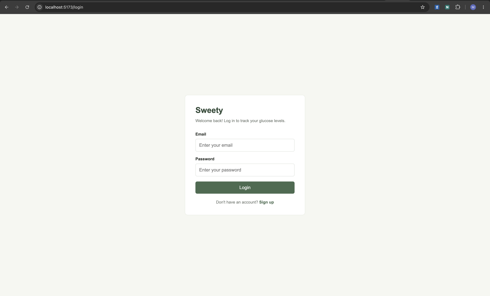
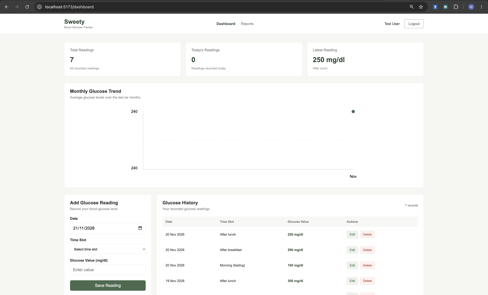
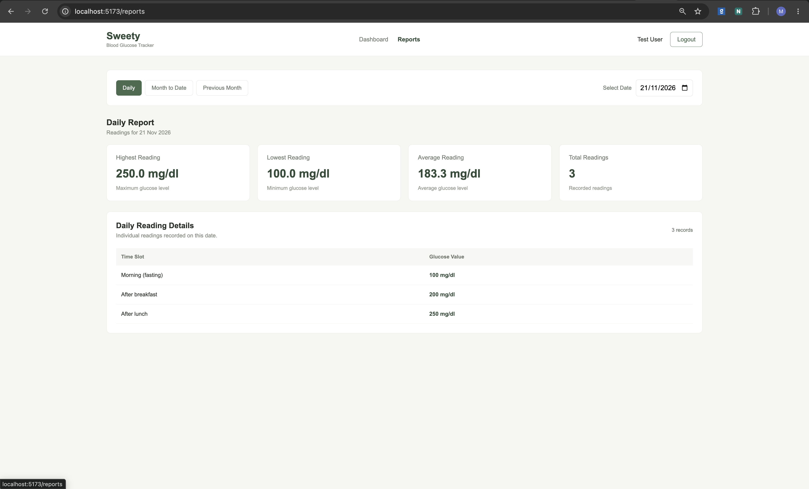

# Sweety – Blood Glucose Tracker

Sweety is a blood glucose tracker which enables you to record, manage and review your glucose readings.

The app provides daily, month to date and previous month reports as well as a monthly glucose trend chart.

## Tech Stack

### Frontend
- React
- Vite
- React Router
- SVG trend chart
- CSS
- Fetch API

### Backend
- Node.js
- Express.js
- PostgreSQL
- JWT Authentication
- bcryptjs

### Testing
- Jest
- Supertest

## Features

### Authentication
- User registration and login
- Password hashing using bcrypt
- JWT-based authentication
- Protected application routes

### Glucose Readings
- Add, edit and delete readings
- Four daily time slots:
  - Morning (fasting)
  - After breakfast
  - After lunch
  - After dinner
- Glucose value validation (40–600 mg/dl)
- Maximum four readings per day
- Duplicate slot prevention
- Future date validation
- User-specific reading access

### Dashboard
- Total readings
- Today's readings
- Latest reading
- Reading history
- Server-side pagination
- Monthly glucose trend chart

### Reports
- Daily report
- Month-to-date report
- Previous-month report
- Highest, lowest and average readings
- Total reading count
- Empty report handling

## Project Structure

```text
sweety-glucose-tracker/
├── client/
│   ├── src/
│   │   ├── components/
│   │   ├── context/
│   │   ├── pages/
│   │   ├── services/
│   │   ├── utils/
│   │   └── App.jsx
│   └── .env.example
│
├── server/
│   ├── src/
│   │   ├── config/
│   │   ├── controllers/
│   │   ├── middleware/
│   │   ├── routes/
│   │   └── utils/
│   ├── database/
│   ├── scripts/
│   ├── tests/
│   └── .env.example
│
├── .gitignore
└── README.md
```

## Requirements

- Node.js
- npm
- PostgreSQL

## Installation

### 1. Clone the repository

```bash
git clone https://github.com/MateenRabiBaig/Sweety-Glucose-Tracker.git
cd sweety-glucose-tracker
```

### 2. Set up the database

Create a PostgreSQL database named:

```sql
CREATE DATABASE sweety_db;
```

Create a database user if necessary and grant that user access to the database.

Run the database schema:

```bash
psql -h localhost -U sweety_user -d sweety_db -f server/database/schema.sql
```

### 3. Configure the backend

```bash
cd server
npm install
```

Copy .env.example to .env and set your database credentials and JWT secret.

Start the backend:

```bash
npm run dev
```

Backend URL:

http://localhost:5001

Health check:

http://localhost:5001/api/health

### 4. Configure the frontend

Open another terminal:

```bash
cd client
npm install
```

Copy `.env.example` to `.env`.

Start the frontend:

```bash
npm run dev
```

Frontend URL:

http://localhost:5173

## Demo Account

A demo account and some sample readings can be created via the seed script.

From the server directory:

```bash
npm run seed
```

Demo credentials:

- Email: demo@sweety.com
- Password: Demo@123

## Running Tests

Backend tests:

```bash
cd server
npm test
```

## API Pagination

The readings endpoint supports pagination using the `page` and `limit` query parameters:

```text
GET /api/readings?page=1&limit=20
```

The response includes the readings for the requested page and pagination details such as the total number of readings and total pages.

## Screenshots

### Login



### Dashboard



### Reports



## Assumptions and Improvements

- Each user can only see their own glucose readings.
- A maximum of four readings can be taken per day.
- Only one reading per date can be scheduled in each time slot.
- The readings are stored as integer values in mg/dl.
- The reports use date ranges based on the calendar.
- APIs are protected using JWT authentication.

Potential future improvements:
- HttpOnly cookie-based authentication.
- Could have improved the UI/UX with better user interface, but due to time constraint kept till here
- UI-wise Validation can be improved further with better toast messages
- More detailed glucose trend analysis.
- Exportable reports.
- Docker-based deployment.
- Additional automated frontend tests.
